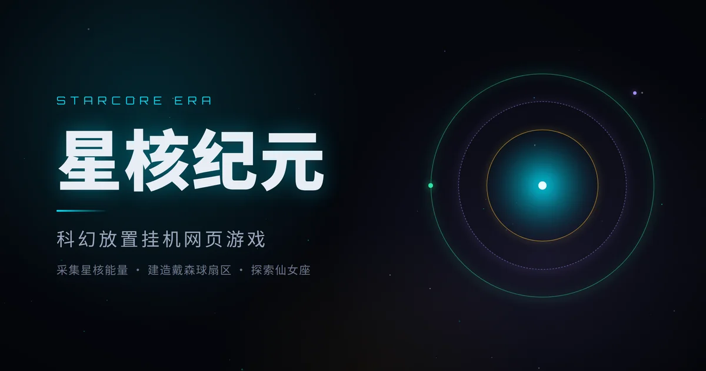

# StarCore Era

[简体中文](README.md) | **English**



A sci-fi idle web game. In 2387 AD, a colony ship arrives at the ruins of a
Dyson sphere in the Andromeda Galaxy. You run a StarCore civilization,
accumulating energy, exploring the stars, conquering strongholds and
collecting relics in the eternal contest between civilization and entropy,
growing through "Singularity Restart" rebirth cycles.

## Gameplay Overview

- **Build**: 20 building types across 5 resources (Energy, Crystal, Alloy,
  Data, Dark Matter); costs escalate
- **Tech Tree**: 8 branches, 59 technologies driving production, combat,
  exploration and rebirth
- **Exploration**: 34 nodes across the StarCore, Stellar, Star Cluster,
  Star Arm, Galaxy and Void layers; timed runs grant rewards
- **Units**: 4 unit types in a double counter-triangle; parallel training
  slots 1→3 via tech; 3 formations each pick one doctrine
  (Assault / Bastion / Counter / Logistics) for combat and garrison roles
- **PVE Strongholds**: 36 strongholds in 4 categories; garrison conquered
  ones for idle output, plus an endless expedition with rising depth —
  every 10 layers conquered unlocks a one-time milestone reward
  (lifetime progress; missed tiers can be claimed later), with a weekly
  boss scaled to the player's expedition frontier every Monday (v1.24)
- **Imperial Strongholds**: 6 holdings along the tribute route on the star
  map; taken-over ones yield tribute continuously (12-hour pool cap, manual
  claim); weekly inspections can be fought at standard or strict difficulty,
  or paid off; each holding supports 3 readiness levels; progress persists
  through rebirth (v1.81)
- **Relics**: 20 kinds drawn from rarity pools; 3 of the same rarity fuse
  into 1 of the next tier; 4 set bonuses; each relic can be enhanced up to
  level 20 with energy
- **Rebirth**: Singularity Restart; negative entropy unlocks a talent tree,
  infinite talents stack, and automation protocols play for you
- **Achievements**: 57 milestones tracked across rebirths, granting permanent
  bonuses (v1.22 adds synthesis, enhancement, set-collection and enemy-archive
  long-term goals; v1.82 adds five Imperial Chronicle goals)
- **Daily Check-in**: streak-cycle rewards plus 3 weekly challenges drawn
  from 9 templates (combat, exploration, research, building, rebirth,
  expedition, synthesis, enhancement, garrison)
- **Bilingual UI**: Simplified Chinese and English; follows your browser by
  default (other languages display in English), switchable in Settings

## Quick Start

### Option 1: Script installation

Best for a direct install or deployment without cloning by hand. Download the
script first:

```bash
curl -fsSL https://raw.githubusercontent.com/renlang119/starcore/main/starcore.sh -o starcore.sh
bash starcore.sh
```

Then choose from the menu:

1. Install the latest development build: the newest commit on `main`, including
   unreleased changes
2. Install the latest stable release: the tag behind the latest GitHub Release,
   built from source the same way
3. Install and deploy
4. Deploy an existing build
5. Run the environment check only

You can also use the command line directly:

```bash
bash starcore.sh install --source release --dir ./starcore
bash starcore.sh deploy --dir ./starcore --dest /var/www/example --url https://example.com
```

See `--help` for every option. The script checks git, Node.js 22.18+, corepack
and related tools first, and asks before installing anything missing. The built
site is written to `dist/` under the install directory.

### Option 2: Manual installation

Best for development or when you want to control the build yourself. Requires
Node.js 22.18+ (24.21 used in development); pnpm 9 is invoked via corepack
(`packageManager` pins 9.15.4, fetched on first run).

```bash
git clone https://github.com/renlang119/starcore.git
cd starcore
corepack pnpm install       # install dependencies
corepack pnpm dev           # dev server at http://localhost:5173
```

Other common commands:

```bash
corepack pnpm build         # type-check + production build into dist/
corepack pnpm test:cov      # tests + coverage thresholds gate
corepack pnpm lint:check    # ESLint
corepack pnpm format:check  # Prettier
corepack pnpm check         # full gate (build + test:cov + conservation + copy + size + lint + format)
```

## Tech Stack

Vue 3 · TypeScript · Vite · Pinia · Vue Router · decimal.js · localforage

Pure front-end, no backend; saves are kept locally in the browser (IndexedDB
with a localStorage backup).

Browser support: ES2020 build target, runs on Chrome/Edge 87+, Firefox 78+,
Safari 14+; both desktop and mobile layouts are supported.

## Project Structure

```text
starcore/
├─ src/
│  ├─ components/   46 components (including 8 icon sub-components), grouped as ui / layout / home / relics / build / army / battle / map / settings
│  ├─ composables/  13 composables (breakpoints, Toast, action queue, onboarding, particles, …)
│  ├─ data/         20 data tables (buildings, tech, exploration, strongholds, relics, achievements, expeditions, weekly boss, encounters, dispatch, units, formation doctrines, navigation, story, background stars, gate echoes, alien behemoth notes, seven-gate files, imperial archive files, imperial strongholds)
│  ├─ i18n/         i18n facade (message lookup and locale detection)
│  ├─ lib/          19 core modules (decimal math, formatting, effect system, offline gains, random, integrity signatures, integer clamping, save pipeline under save/, batch and cost helpers, …)
│  ├─ locales/      locale bundles (zh-CN baseline + en English, split by domain under ui/ and content/)
│  ├─ router/       route definitions
│  ├─ stores/       14 Pinia stores (resources, buildings, research, military, combat,
│  │                exploration, relics, rebirth, achievements, daily, archive, encounters,
│  │                imperial, game)
│  ├─ styles/       8 style modules (tokens, base, fonts, buttons, Toast, animations, background, utilities)
│  ├─ tests/        test harness (vitest setup and shared helpers)
│  ├─ views/        11 views (home, build, tech, map, army, battle, relics, rebirth, achievements, archive, settings)
│  └─ App.vue / app.ts / main.ts / version.ts / style.css
├─ docs/            12 specification documents (in Chinese), see Documentation
├─ references/      reference materials (English copy glossary)
├─ public/          favicon, touch icon, share image and self-hosted fonts (Orbitron, JetBrains Mono)
├─ scripts/         quality scripts (count conservation, message key checks, bundle size budget)
├─ tools/           diagnostics (environment self-check, end-to-end and numeric)
├─ .github/         CI workflow (full checks on push to main)
├─ changelog/       version history; active file and three archives
├─ starcore.sh      install and deployment script
└─ project configs (vite.config.ts, vitest.config.ts, tsconfig*.json, eslint.config.js)
```

## Quality

- **Unit / component tests**: Vitest + @vue/test-utils + jsdom; 68 test files,
  934 cases
- **Types & conventions**: vue-tsc type checking in the build; ESLint and
  Prettier pass with zero output
- **Count conservation**: `scripts/check-conservation.mjs` validates document
  counts, achievement text links and test hard assertions against real data
  (`corepack pnpm check:conservation`)
- **Copy guard**: `scripts/check-locales.mjs` gates message-key closure (missing /
  unused / non-literal calls), zero hardcoded Chinese residuals and
  cross-locale key parity; wired into `corepack pnpm check`
- **Coverage gate**: vitest coverage thresholds on three tiers (global lines
  >= 92% / stores >= 97% / lib >= 94%, global and stores rounded down from the
  v1.66 measured baseline, lib from the v1.70 baseline), enforced via
  `corepack pnpm test:cov` in the check chain
- **Bundle size budget**: `scripts/check-size.mjs` gates the gzip total of the
  dist output (js/css/html) at 280 KiB; over-budget fails the run
  (`--warn-only` is the escape hatch for exceptional cases)
- **Balance checks**: the CI `balance` job runs the v126 / v127 EV verification
  scripts in sequence (skipped explicitly when python3 is absent), see
  `tools/README.md`

## Self-check & Diagnostics

The repository ships a companion toolset for checking your environment and deployment targets:

```bash
corepack pnpm diagnose        # environment & repo self-check with fix hints
corepack pnpm diagnose --fix  # repair fixable missing pieces
```

The self-check covers Node, dependencies, build output, the browser and Python prerequisites. For end-to-end and numeric diagnostics, see `tools/README.md`. Since v1.67 the balance checks also run in CI (a dedicated `balance` job with a python3 optional guard); local recomputation still uses the same scripts.

## Documentation

> All design documents are currently written in Chinese.

- [游戏设定与架构](docs/游戏设定与架构.md) · Game Design & Architecture
- [游戏数值设定规范](docs/游戏数值设定规范.md) · Numerical Design Specification
- [设计令牌规范](docs/设计令牌规范.md) · Design Token Specification
- [组件与按钮设计规范](docs/组件与按钮设计规范.md) · Components & Buttons Specification
- [交互状态规范](docs/交互状态规范.md) · Interaction States Specification
- [氛围视觉规范](docs/氛围视觉规范.md) · Atmosphere & Visuals Specification
- [体验增强设计规范](docs/体验增强设计规范.md) · Experience Enhancements Specification
- [动效规范](docs/动效规范.md) · Motion Design Specification
- [存档与数据安全规范](docs/存档与数据安全规范.md) · Save Data & Security Specification
- [弹窗与确认流规范](docs/弹窗与确认流规范.md) · Dialogs & Confirmation Flows Specification
- [图标设计规范](docs/图标设计规范.md) · Icon Design Specification
- [UI回归体检清单](docs/UI回归体检清单.md) · UI Regression Checklist

## Version History

- [changelog.md](changelog/changelog.md) · from v1.51, newest first
- [changelog-v1.06-v1.48.md](changelog/changelog-v1.06-v1.48.md) · v1.06 to v1.48 archive
- [changelog-v0.58-v1.05.md](changelog/changelog-v0.58-v1.05.md) · v0.58 to v1.05 archive
- [changelog-v0.01-v0.57.md](changelog/changelog-v0.01-v0.57.md) · v0.01 to v0.57 archive

## Deployment

A pure static SPA. The build output goes to `dist/`. The unified script can
deploy it to a local site:

```bash
./starcore.sh deploy --dir . --dest /var/www/example --url https://example.com
```

`--dest` is the target directory, and `--url` injects share metadata and
verifies the live site. Add `--sudo`, `--delete`, `--backup` and other options
as needed; see `./starcore.sh --help`.

## Updating

When a new version is released, pull the latest code and deploy again:

```bash
git pull
corepack pnpm install   # run when dependencies have changed
./starcore.sh deploy --dir . --dest /var/www/example --url https://example.com
```

- Pass site settings with `--dest` / `--url`, or keep them in `deploy.env`.
- Updates do not affect game saves, which are kept locally in the browser.
- Any writable directory can be the target; add `--sudo` when needed.
- If you prefer not to use the command line, a prebuilt archive is available
  on the [Releases](https://github.com/renlang119/starcore/releases) page:
  unzip and copy the contents of `dist/` over your site files to deploy or
  update.

## License

[MIT](LICENSE) © 2026 renlang119

UI fonts Orbitron and JetBrains Mono are licensed under the SIL Open Font
License 1.1.
